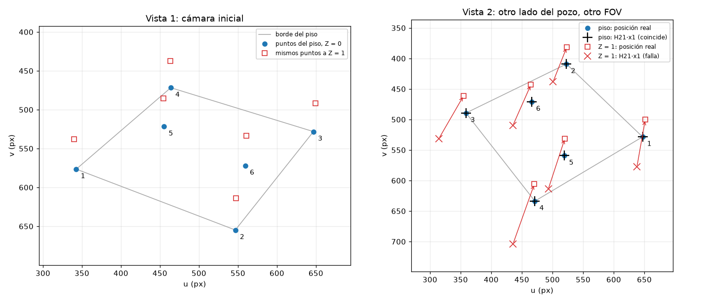

# Informe — Blockout desde una cámara móvil

Visión por Computador · Ingeniería Electrónica · UTP · 2026-II

Este informe responde al entregable del enunciado (§10): cadena de proyección, derivación de la homografía,
resultados numéricos y limitaciones conocidas. Se construye por etapas: la sección 2 (homografía, E7) está
completa; las demás se terminan en E10.

---

## 1. Cadena de proyección

_Se completa en E10._ Notación usada en la sección 2 (detalle en `docs/INTERFACES.md` §1):

```
λ [u v 1]ᵀ = K · [R | t] · M · [X Y Z 1]ᵀ,     λ = z_cam
```

Mundo de mano derecha con `Z` hacia arriba y piso en `Z = 0`; cámara estilo OpenCV (`x` derecha, `y` abajo,
`z` adelante); `K` desde el FOV horizontal, `f = (W/2)/tan(fov/2)`; `rᵢ` es la columna `i` de `R`.

---

## 2. Homografía inducida por el piso (E7)

El enunciado (§3) pide distinguir la proyección de una homografía, y demostrarlo en cuatro pasos: elegir un
plano, derivar la homografía entre dos vistas, verificarla con al menos cuatro puntos en posición general y
mostrar por qué no sirve para puntos fuera del plano cuando cambia el centro de la cámara.

### 2.1 Tres matrices que no son lo mismo

| Matriz | Tamaño | Qué hace | En el código |
| --- | --- | --- | --- |
| Transformación 3D `M` (la rígida es un caso particular) | 4×4, invertible | Mueve puntos del espacio 3D: de la pieza al mundo | `scene.model_matrix` |
| Proyección de cámara `P = K[R \| t]` | 3×4, rango 3 | Lleva un punto 3D a la imagen. No es cuadrada ni invertible: pierde la profundidad, así que no es una homografía | `Camera.P` |
| Homografía `H` | 3×3, invertible | Relaciona las imágenes de **un mismo plano** en dos vistas | `projection.homography` |

`P` no se puede invertir porque todos los puntos de un rayo de la cámara caen en el mismo píxel. La homografía
existe solo porque, al restringirse a un plano, cada rayo corta el plano en **un solo** punto: así vuelve a haber
una correspondencia uno a uno entre los píxeles y los puntos del plano.

### 2.2 Derivación

**Plano.** Se usa el piso del contenedor, `Z = 0`, que es el "fondo del pozo" que sugiere el enunciado. En
general, un plano se describe con un origen `O` y dos direcciones `e₁`, `e₂`: sus puntos son `X = O + a·e₁ + b·e₂`.
Para el piso, `O = (0,0,0)`, `e₁ = X` y `e₂ = Y`, de modo que `(a, b) = (X, Y)`.

**Del plano a una imagen.** Sustituyendo en la cadena de proyección de la vista `i`:

```
λ x = K [R | t] (O + a e₁ + b e₂, 1)ᵀ = K [ R e₁ | R e₂ | R O + t ] (a, b, 1)ᵀ = Hᵢ (a, b, 1)ᵀ
```

Para el piso, `R e₁ = r₁`, `R e₂ = r₂` y `R O + t = t`:

```
Hᵢ = Kᵢ [ r₁ⁱ | r₂ⁱ | tᵢ ]   (3×3)
```

Es `P` sin su tercera columna: como `Z = 0`, esa columna siempre se multiplica por cero. `Hᵢ` es invertible
siempre que la cámara no esté contenida en el plano. Si lo está, ve el piso de canto, todo el plano se proyecta
sobre una recta de la imagen y `Hᵢ` es singular. El código detecta ese caso y lanza un error. Es justo lo que pasa
con la cámara del ejemplo compartido de E2, que está en `Z = 0`.

**Entre las dos imágenes.** De `x₁ ~ H₁ p` y `x₂ ~ H₂ p`, con `p = (a, b, 1)`, se despeja `p ~ H₁⁻¹ x₁`:

```
x₂ ~ H₂ H₁⁻¹ x₁   ⟹   H₂₁ = H₂ · H₁⁻¹
```

El símbolo `~` significa "igual salvo un factor de escala": las coordenadas homogéneas `(u, v, 1)` y
`(k u, k v, k)` son el mismo píxel. Por eso `H₂₁` se define salvo escala y se normaliza con `H₂₁[3,3] = 1`.
Le quedan 8 grados de libertad, y cada correspondencia de puntos aporta 2 ecuaciones: de ahí el mínimo de
**4 puntos**.

**Comprobación por un segundo camino.** Con el plano escrito como `n₁ᵀ X = d₁` en coordenadas de la cámara 1, y
el movimiento de la cámara 1 a la 2 como `X_c2 = R X_c1 + t` (con `R = R₂ R₁ᵀ` y `t = t₂ − R t₁`), un punto del
plano cumple `1 = n₁ᵀ X_c1 / d₁`. Entonces `X_c2 = (R + t n₁ᵀ/d₁) X_c1`, y multiplicando por `K₂` y `K₁⁻¹`:

```
H₂₁ = K₂ (R + t n₁ᵀ / d₁) K₁⁻¹
```

Las dos fórmulas dan la misma matriz: la diferencia máxima entre sus entradas es `3.4e-13`, que es error de
redondeo (`homography_from_plane_normal`). Este segundo camino además muestra de dónde viene el problema fuera
del plano: el término `t n₁ᵀ/d₁` depende del plano, y desaparece solo si `t = 0`, es decir, si la cámara no
cambia de centro.

### 2.3 Montaje del experimento

Script: `experiments/homography_experiment.py`. Escribe `results/homografia.json`, `results/homografia.md` y
`results/homografia.png`. Es determinista: la única aleatoriedad, el ruido, usa la semilla fija 2026.

**Vistas.** Ambas se construyen con la cámara orbital del módulo B, a 1000×700 píxeles.

| Vista | Azimut | Elevación | Distancia | FOV | Centro en el mundo |
| --- | --- | --- | --- | --- | --- |
| 1 (cámara inicial de la aplicación) | −60° | 25° | 22 | 50° | (12.47, −14.77, 14.30) |
| 2 (otro lado del pozo) | 145° | 40° | 20 | 55° | (−10.05, 11.29, 17.86) |

Las dos tienen distinto centro y distinto FOV, así que `K₁ ≠ K₂`. No se usó el azimut exactamente opuesto
(120°): con los dos centros en el mismo plano vertical que pasa por el objetivo, `H₂₁` salía con ceros
estructurales, una configuración simétrica especial. Con 145° la matriz es genérica:

```
H₂₁ = [  1.207397   -3.417572   401.699005 ]
      [  0.251506   -0.365235  -818.652258 ]
      [ -0.000552   -0.004502     1        ]        det = −6.11, rango 3
```

**Puntos.** Las 4 esquinas del piso y 2 puntos interiores. Los interiores se eligieron por búsqueda: entre todos
los pares de una rejilla de medio cubo, son los que alejan más a cualquier punto de la recta que pasa por otros
dos, en las dos imágenes a la vez. La "posición general" se verifica **en la imagen**, como pide el enunciado.
El margen es la menor distancia de un punto a la recta de otros dos: 28.4 px en la vista 1 y 30.5 px en la
vista 2.

| # | Punto del piso (X, Y) | Vista 1 (u, v) px | Vista 2 (u, v) px |
| --- | --- | --- | --- |
| 1 | (0, 0) | (342.7, 576.5) | (647.0, 528.4) |
| 2 | (5, 0) | (546.7, 654.8) | (522.8, 409.1) |
| 3 | (5, 5) | (646.8, 528.2) | (358.8, 489.3) |
| 4 | (0, 5) | (463.9, 471.7) | (471.3, 633.7) |
| 5 | (1, 3) | (455.3, 521.6) | (519.6, 559.2) |
| 6 | (4, 2.5) | (559.4, 571.9) | (465.8, 470.9) |

**Estimación por DLT.** Además de la `H₂₁` analítica, se estima a partir de las correspondencias con DLT
normalizado (`estimate_homography_dlt`). De `x' ~ H x` salen dos ecuaciones lineales por punto en las 9 entradas
de `H`, que forman `A h = 0`. La solución es el vector singular de `A` con el menor valor singular. Antes se aplica
la normalización de Hartley (centroide en 0 y distancia media √2): sin ella, `A` mezcla números de orden 1 con
números de orden 10⁶ y la SVD pierde precisión. Todo está escrito con numpy; no se usa OpenCV.

### 2.4 Resultados

Errores de reproyección: distancia en píxeles entre `H₂₁·x₁` y la posición real en la vista 2. Los errores
menores que `1e-9` se escriben como `< 1e-9`: son del orden de `1e-13` y su valor exacto depende de la librería
de álgebra lineal de cada máquina. El JSON tiene las cifras completas.

| Caso | Error medio (px) | Mediana (px) | Error máximo (px) |
| --- | --- | --- | --- |
| 6 puntos del piso, H21 analítica | < 1e-9 | < 1e-9 | < 1e-9 |
| 6 puntos del piso, H21 estimada por DLT sin ruido | < 1e-9 | < 1e-9 | < 1e-9 |
| Mismos 6 puntos elevados a Z = 0.25, misma H21 | 18.81 | 18.57 | 23.91 |
| Mismos 6 puntos elevados a Z = 0.5, misma H21 | 38.47 | 37.95 | 49.10 |
| Mismos 6 puntos elevados a Z = 1.0, misma H21 | 80.63 | 79.44 | 103.87 |
| Mismos 6 puntos elevados a Z = 2.0, misma H21 | 179.08 | 175.92 | 235.79 |
| 114 vértices de las piezas de la escena (Z de 2 a 9), misma H21 | 10060.67 | 809.20 | 548963.31 |
| Mismo centro de cámara, puntos a Z = 0.25 | < 1e-9 | < 1e-9 | < 1e-9 |
| Mismo centro de cámara, puntos a Z = 0.5 | < 1e-9 | < 1e-9 | < 1e-9 |
| Mismo centro de cámara, puntos a Z = 1.0 | < 1e-9 | < 1e-9 | < 1e-9 |
| Mismo centro de cámara, puntos a Z = 2.0 | < 1e-9 | < 1e-9 | < 1e-9 |

Con ruido gaussiano de σ = 0.5 px agregado a las dos vistas, en 200 repeticiones, el error se mide contra la
verdad **sin ruido**: así se mide cuánto se equivoca la `H` estimada, no cuánto ruido se agregó. La malla son
121 puntos del piso que **no** se usaron para estimar `H`.

| Puntos usados | En sus puntos (px) | En una malla de 121 puntos del piso (px) | Malla, percentil 95 (px) |
| --- | --- | --- | --- |
| 4 esquinas (mínimo) | 0.959 | 0.713 | 1.119 |
| 6 puntos | 0.780 | 0.631 | 0.897 |



En la vista 2, las cruces negras (`H₂₁·x₁` para el piso) caen exactamente sobre los puntos azules (posición real).
Las ✕ rojas (`H₂₁·x₁` para los mismos puntos a `Z = 1`) caen lejos de los cuadrados rojos (posición real), y cada
flecha muestra el error.

### 2.5 Interpretación

**En el plano, la derivación es exacta.** El error de `1e-13` px es el límite del punto flotante de doble
precisión, no un error del método. El DLT sin ruido recupera la misma matriz: la diferencia máxima entre sus
entradas es `2.8e-13`. Así quedan comprobados a la vez la fórmula y la implementación del estimador.

**Con ruido, el error es del orden del ruido.** Con σ = 0.5 px, la `H` estimada se equivoca en promedio unos
0.6–0.7 px sobre todo el piso. Con 6 puntos el error es menor que con las 4 esquinas, porque el sistema
sobredeterminado (12 ecuaciones para 8 incógnitas) promedia el ruido por mínimos cuadrados. El error en los puntos
de estimación es algo mayor que en la malla porque las esquinas son los puntos más extremos, donde un error en `H`
pesa más.

**Fuera del plano, la misma `H` falla, y por una razón que se puede escribir.** Para un punto a altura `Z`:

```
λᵢ xᵢ = Kᵢ [r₁ⁱ r₂ⁱ r₃ⁱ tᵢ] (X, Y, Z, 1)ᵀ = Hᵢ (X, Y, 1)ᵀ + Z · eᵢ,     eᵢ = Kᵢ r₃ⁱ
```

`eᵢ` es la imagen de la dirección vertical en la vista `i`. Al aplicar `H₂₁` al punto de la vista 1:

```
H₂₁ (λ₁ x₁) = H₂ (X, Y, 1)ᵀ + Z · H₂₁ e₁,     pero     λ₂ x₂ = H₂ (X, Y, 1)ᵀ + Z · e₂
```

La parte del plano coincide, pero sobra un término proporcional a `Z`, y `H₂₁ e₁` no es (proporcional a) `e₂`
cuando los centros son distintos. El experimento calcula el punto que predice esta fórmula y lo compara con el que
da `project_points`: la diferencia máxima es `2.8e-13` px. **La explicación predice el error al píxel.**

Geométricamente: `H₂₁` no sabe nada de alturas. Trata cada píxel `x₁` como si fuera la imagen del **punto del piso**
que está en el mismo rayo de la cámara 1, y lo lleva a donde se vería ese punto del piso desde la cámara 2. Para un
punto elevado, ese punto del piso está en otro lugar. Desde otro centro de cámara se ve desplazado: eso es el
**paralaje**. Por eso el error es cero en `Z = 0` y crece con la altura: 18.8, 38.5, 80.6 y 179.1 px para
`Z` = 0.25, 0.5, 1 y 2. Crece casi linealmente, como el término `Z · (…)`, y un poco más rápido porque también
cambian las profundidades `λ`.

Con los vértices reales de las piezas (los datos del módulo A, de `Z = 2` a `Z = 9`), la mediana es de 809 px y
el máximo de más de 5·10⁵ px. Un vértice alto visto desde la cámara 1 está en un rayo casi paralelo al piso, que
corta el piso muy lejos. Llevado a la vista 2, ese punto lejano cae muy fuera de la imagen. Por eso se reporta la
mediana y no solo la media, que este caso arrastra.

**Lo que falla es el cambio de centro, no el giro ni la focal.** La vista 3 tiene el **mismo centro** que la 1,
pero mira a otro punto y tiene FOV 60°. Ahí la homografía del piso es igual a `K₃ R K₁⁻¹` (diferencia `3.9e-14`)
y acierta también los puntos elevados: el error queda por debajo de `1e-9` px incluso a `Z = 2`. En la fórmula
de 2.2, con `t = 0` el término `t n₁ᵀ/d₁` desaparece, y `H` ya no depende de ningún plano: vale para toda la
escena. Esto responde el paso 4 del enunciado: la homografía de un plano sirve para puntos fuera de él solo si la
cámara no cambia de centro.

### 2.6 Limitaciones del experimento

- **Datos sintéticos.** Las correspondencias salen de nuestra propia cadena de proyección. El experimento demuestra
  que la derivación y el código son consistentes entre sí, pero no calibra una cámara real.
- **Ruido idealizado.** Es gaussiano, independiente, del mismo tamaño en las dos vistas y sin valores atípicos.
  Con correspondencias reales habría que agregar un estimador robusto (por ejemplo, RANSAC), que no se implementó.
- **Un solo plano por homografía.** Para la pared del fondo (`Y = 5`) la misma función da otra `H`. Está
  comprobado en `tests/test_homography.py`, pero no se reporta en las tablas.
- **Puntos cerca de la línea del horizonte del plano.** Si un píxel de la vista 1 está cerca de la imagen de la
  línea del infinito del piso, `H₂₁` lo lleva muy lejos, como pasa con los vértices altos. No es un fallo numérico:
  es el comportamiento correcto de la homografía.

### 2.7 Cómo se verifica

`tests/test_homography.py` (17 pruebas) comprueba la derivación (`H = P` sin su tercera columna, las dos fórmulas
iguales en 50 pares de cámaras al azar, también la pared del fondo), la verificación (posición general, error
`< 1e-7` px en 50 pares, DLT exacto con 4 y con 6 puntos, DLT con ruido del orden de σ, datos degenerados
rechazados), el paralaje (cero solo en el plano, creciente con `Z`, fórmula igual al medido), el caso de mismo
centro y la cámara sobre el plano. Además, dos pruebas vuelven a correr el experimento y fallan si
`results/homografia.json`, `results/homografia.md` o las tablas de **este informe** no coinciden con lo que sale:
las cifras de esta sección no pueden quedar desactualizadas.

---

## 3. Limitaciones conocidas del sistema

_Se completa en E10._ Anotadas hasta ahora:

- No se detectan colisiones entre piezas (R34 es opcional): dos piezas pueden ocupar la misma celda.
- El algoritmo del pintor ordena caras y aristas completas por su profundidad media. Una arista larga del
  contenedor o dos caras que se cruzan pueden quedar en orden incorrecto vistas muy de cerca.

## 4. Contribuciones

_Se completa en E10_, con enlaces a commits, PR y revisiones de cada integrante.
